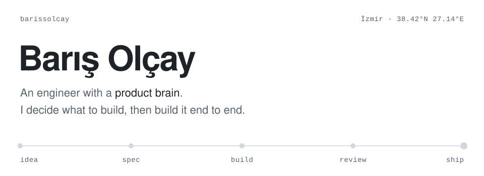

<picture>
  <source media="(prefers-color-scheme: dark)" srcset="assets/head-dark.svg">
  
</picture>

 

Computer engineering graduate from Dokuz Eylül University, based in İzmir. I like owning the whole path of a product: deciding what is worth building, writing the spec, building it with AI coding agents, reviewing every change, and shipping it to real people.

 

<a href="https://healthverse.app">
  <picture>
    <source media="(prefers-color-scheme: dark)" srcset="assets/hv-home-dark.svg">
    
  </picture>
</a>

  <a href="https://healthverse.app">healthverse.app</a>&nbsp;&nbsp;·&nbsp;&nbsp;<a href="https://apps.apple.com/tr/app/healthverse/id6765671137">App Store</a>&nbsp;&nbsp;·&nbsp;&nbsp;<a href="https://play.google.com/store/apps/details?id=com.healthverse.mobile">Google Play</a>
   
  Flutter · ASP.NET Core · PostgreSQL · React &nbsp;—&nbsp; mobile app, API, database, admin panel and website, built and run by one person.

 

### How I work

**Spec before code.** I split a feature into small, precise tasks before anything gets written, whether the builder is me, a team, or an AI agent.

**Agents write, I own.** Claude Code, Codex and Cursor are part of my daily workflow. Architecture, review, debugging and release decisions stay with me.

**Feedback closes the loop.** HealthVerse's sign-up flow, health sync and notifications were all reworked from what users told me.

 

### Also on my GitHub

**[TelcoAssist](https://github.com/barissolcay/telecom-support-intelligence)** · A grounded AI copilot for telecom support teams: RAG over a knowledge base, ticket triage and priority prediction. [Live demo →](https://barissolcay.github.io/telecom-support-intelligence/)

**[BIST Early Moves](https://github.com/barissolcay/bist-tahmin)** · A research framework for early price moves on Borsa İstanbul, built around a frozen methodology and point-in-time data.

**[Portfolio Optimization](https://github.com/barissolcay/portfolio_optimization)** · A Streamlit dashboard for mean-variance optimization, validated with walk-forward backtests.

 

### Toolbox

| Mobile | Backend | Data | AI |
|:--|:--|:--|:--|
| Flutter · React Native (Expo) | ASP.NET Core · FastAPI · REST | PostgreSQL · Supabase · Firebase | RAG · vector search · LLM integration |
| Dart · TypeScript | C# · Python · Java | SQL · Docker · CI/CD | Claude Code · Codex · Cursor |

 

### Off the keyboard

500+ hours of one-on-one teaching in Java, C# and Python. Built the whole React Native frontend of the PMI Türkiye İzmir chapter's volunteer app with a five-person team. Ran promotion and design for IEEE DETECH, a 1,800-person tech conference.

 
 

  <a href="https://www.linkedin.com/in/bar%C4%B1%C5%9F-ol%C3%A7ay/">LinkedIn</a>&nbsp;&nbsp;·&nbsp;&nbsp;<a href="mailto:barisolcaay@gmail.com">barisolcaay@gmail.com</a>&nbsp;&nbsp;·&nbsp;&nbsp;<a href="https://healthverse.app">healthverse.app</a>

