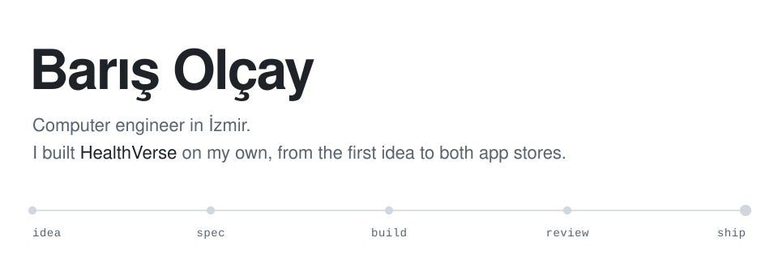

<picture>
  <source media="(prefers-color-scheme: dark)" srcset="assets/top-dark.svg">
  
</picture>

 

Hi, I'm Barış. I finished computer engineering at Dokuz Eylül University in 2026. Over the past year I built HealthVerse by myself: the Flutter app, the .NET backend, the database, the admin panel and the website. Doing every part of it taught me that the code is rarely the hardest part. Deciding what is worth building, and listening when people tell you it isn't working, usually is.

I'm looking for my next team: **software engineering roles** (mobile, backend or full-stack) or **product roles** such as associate product manager. İzmir, İstanbul or remote.

 

<a href="https://healthverse.app">
  <picture>
    <source media="(prefers-color-scheme: dark)" srcset="assets/hv-home-dark.svg">
    
  </picture>
</a>

  <a href="https://healthverse.app">healthverse.app</a>&nbsp;&nbsp;·&nbsp;&nbsp;<a href="https://apps.apple.com/tr/app/healthverse/id6765671137">App Store</a>&nbsp;&nbsp;·&nbsp;&nbsp;<a href="https://play.google.com/store/apps/details?id=com.healthverse.mobile">Google Play</a>
   
  Flutter · ASP.NET Core · PostgreSQL · React. The app is in Turkish and the code is private, but I'm happy to walk you through it.

 

### What building it alone taught me

**Write it down first.** Before I start a feature, I write down what it should do and what it shouldn't, in pieces small enough to finish in one sitting. That habit matters even more now that AI coding tools write a lot of the code: they work from what I write, and I read every change before it ships.

**People will use it differently than you planned.** HealthVerse's sign-up flow, health sync and notifications all changed after real people used them and told me what didn't work.

**Shipping is a job of its own.** Store reviews, release builds, tests in CI and fixing things in production take as much care as building the features.

 

### Smaller things I've built

**[Meet not alma botu](https://github.com/barissolcay/meet-not-alma-botu)** · A note-taking Chrome extension for Google Meet. It joins at the time you set, turns the live captions into a transcript with names and timestamps, and gets it ready for an AI summary. Nothing leaves your computer.

**[Sanal Ajanda](https://github.com/barissolcay/sanal-ajanda-public)** · A planner I made for my own days and weeks, with daily to yearly views. You can install it on your phone like an app. React, TypeScript and Supabase.

**[RAG Course Assistant](https://github.com/barissolcay/rag-course-assistant)** · Point it at a folder of course PDFs and slides, ask a question, and it answers with the pages the answer came from. Runs locally, and reads scanned pages too.

 

### What I work with

| Mobile | Backend | Data | AI |
|:--|:--|:--|:--|
| Flutter · React Native (Expo) | ASP.NET Core · FastAPI · REST | PostgreSQL · Supabase · Firebase | RAG · vector search · LLM integration |
| Dart · TypeScript | C# · Python · Java | SQL · Docker · CI/CD | Claude Code · Codex · Cursor |

 

### Outside my own projects

I've spent more than 500 hours teaching Java, C# and Python one-on-one. I volunteer with PMI Türkiye in İzmir: on the chapter's volunteer app, I pointed out missing screens and flows before development started, then built the whole React Native frontend with a team of five. At university, I ran promotion and design for IEEE DETECH, a tech conference with more than 1,800 attendees.

 
 

  <a href="https://www.linkedin.com/in/bar%C4%B1%C5%9F-ol%C3%A7ay/">LinkedIn</a>&nbsp;&nbsp;·&nbsp;&nbsp;<a href="mailto:barisolcaay@gmail.com">barisolcaay@gmail.com</a>&nbsp;&nbsp;·&nbsp;&nbsp;<a href="https://healthverse.app">healthverse.app</a>

